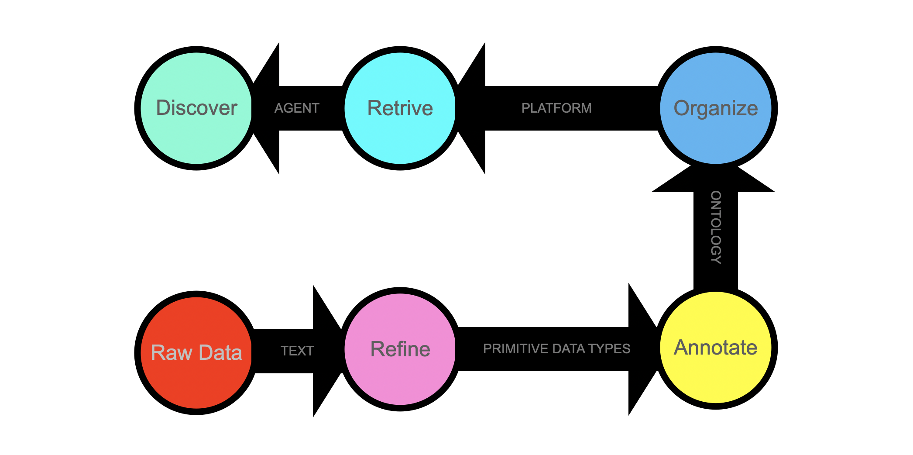

# Mario Foglio
### Research Engineer & Systems Architect | Creator of Interlace
**Paris, France** · [LinkedIn](https://linkedin.com/in/foglio) · [Google Scholar](https://scholar.google.com/citations?user=lTjV648AAAAJ) · [sas-quantome.com](https://www.sas-quantome.com)

Principal systems builder with 20+ years engineering high-throughput genomic data infrastructure and low-latency data engines. Specializing in eliminating upstream I/O bottlenecks in deep learning pipelines through zero-copy memory mapping (`mmap`), deterministic DAG workflow orchestration, and high-performance Go/C systems.

---

### Core Open-Source Ecosystem ([@sas-quantome](https://github.com/sas-quantome))

* **[interlace-go](https://github.com/sas-quantome/interlace-go)**: High-throughput columnar data shredding engine in Go. Converts heterogeneous multi-omic formats (VCF, BAM, GFF3, ClinVar, XML) into vertically partitioned Structure-of-Arrays (SoA) binary assets for zero-copy memory-mapped ([`mmap`](https://github.com/sas-quantome/interlace-go/blob/main/pkg/README.md#12-binary-file-integrity-check)) ingestion by PyTorch and NumPy.
* **[interlace-do](https://github.com/sas-quantome/interlace-do)**: Deterministic DAG workflow orchestrator ([`a32005`](https://github.com/sas-quantome/interlace-do/blob/main/cmd/a32005/README.md)) executing parallel bio-data refinement pipelines under strict worker pool constraints with full provenance journaling ([`/event/...`](https://github.com/sas-quantome/interlace-go/blob/main/pkg/README.md#10-directory-architecture-entities-and-events)).
* **[interlace-ex](https://github.com/sas-quantome/interlace-ex)**: Reference architecture and benchmarks demonstrating a 40x footprint reduction—consolidating 57 GB of multi-source biological data into 1.4 GB of immutable binary assets in ~5 minutes.

---

### Technical Focus & Systems Stack

* **Systems & Languages:** Go (Golang), C, POSIX/UNIX Shell, Python (NumPy, PyTorch C-API interop)
* **Storage & Memory Architecture:** Zero-copy `mmap`, Structure-of-Arrays (SoA), embedded key-value engines (Berkeley DB), custom self-describing wire formats with MD5 validation
* **Compute & Orchestration:** Deterministic DAGs, concurrent worker pools, Amazon EKS, Google Cloud Platform (GCP), Slurm/HPC clusters
* **Domain Foundations:** Molecular Biology (B.Sc., UCSD), Software Engineering (M.Sc.), PB-scale sequencing platforms (CEA/CNG), 40+ co-authored peer-reviewed publications

###### November 10, 2026: main readme v112
